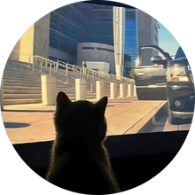
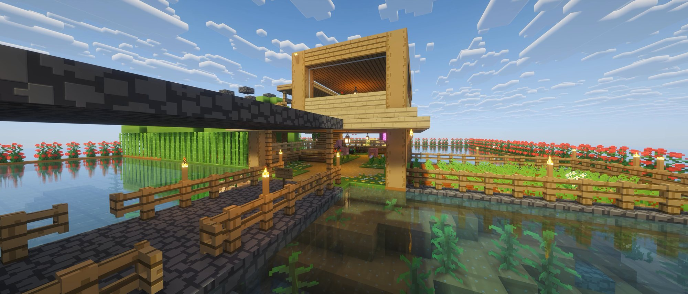

<!--
  ─────────────────────────────────────────────────────────────
  wunanc · GitHub profile
  Plain Markdown + a few HTML blocks — edit any line freely.
  · avatar / cover / wave  →  ./img
  · contribution snake     →  .github/workflows/snake.yml
  ─────────────────────────────────────────────────────────────
-->

  

<h1 align="center">Hi, I'm wunanc 👋</h1>

  

  
  

  I build Minecraft server plugins and small web tools — mostly in Java, TypeScript and Python. 
  When I'm not shipping, I'm somewhere with a lot of blocks and no compiler.

<h3 align="center">🧱 Off the clock</h3>

  
   
  Made entirely of rectangles.

<h3 align="center">📊 GitHub at a glance</h3>

  <picture>
    <source
      media="(prefers-color-scheme: dark)"
      srcset="https://github-stats-extended.vercel.app/api?username=wunanc&show_icons=true&theme=dark_github&hide_border=true&bg_color=00000000"
    />
    
  </picture>
  &nbsp;&nbsp;
  <picture>
    <source
      media="(prefers-color-scheme: dark)"
      srcset="https://streak-stats.demolab.com?user=wunanc&theme=github-dark&hide_border=true"
    />
    
  </picture>

<h3 align="center">🧰 Toolbox</h3>

  

<h3 align="center">🐍 Contribution snake</h3>

<!-- Generated daily by .github/workflows/snake.yml → "output" branch.
     Run the workflow once (Actions → Generate snake → Run workflow) and it shows up here. -->

  <picture>
    <source
      media="(prefers-color-scheme: dark)"
      srcset="https://raw.githubusercontent.com/wunanc/wunanc/output/github-snake-dark.svg"
    />
    <source
      media="(prefers-color-scheme: light)"
      srcset="https://raw.githubusercontent.com/wunanc/wunanc/output/github-snake.svg"
    />
    
  </picture>

 

  Thanks for stopping by — always happy to talk plugins, servers or blocks.

  

